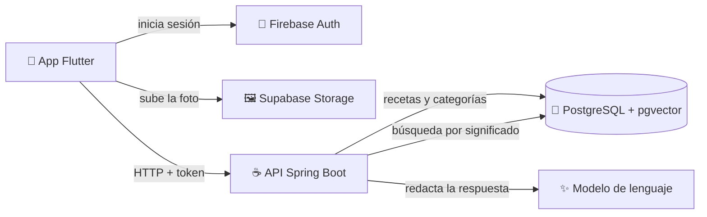

<div align="center">

# 🍳 Recetario · Backend

**La API detrás de un recetario que cocina contigo**


[📱 App móvil](https://github.com/Fernando-Castro-Hernandez/recetario-frontend) ·
[Cómo se conecta todo](#-cómo-se-conecta-todo) ·
[Arquitectura](#-arquitectura) ·
[Puesta en marcha](#-puesta-en-marcha) ·
[Roadmap](#-roadmap)

</div>

---

> 🚧 **Proyecto recién iniciado.** Hoy el repositorio contiene el esqueleto generado con Spring Initializr. Lo marcado como *planeado* todavía no está implementado; el [roadmap](#-roadmap) dice qué existe y qué falta.

## 🥘 ¿Qué es?

**Recetario** es una app móvil para guardar tus recetas y cocinar con ayuda de un asistente que responde **con base en tus propias recetas**: *"¿qué hago con pollo y arroz en 20 minutos?"*.

Este repositorio es el **backend**: una API REST que guarda las recetas, las busca y, más adelante, conversa sobre ellas. La app que la consume vive en [`recetario-frontend`](https://github.com/Fernando-Castro-Hernandez/recetario-frontend).

## 🔌 Cómo se conecta todo



| Pieza | Para qué sirve |
|---|---|
| **Firebase Auth** | Sabe quién eres: registro, login y Google. Entrega un token a la app. |
| **Supabase Storage** | Guarda la foto de cada receta y devuelve una URL pública. |
| **API Spring Boot** *(este repo)* | Recibe las peticiones de la app, valida el token y aplica las reglas del negocio. |
| **PostgreSQL** | Guarda recetas y categorías. Con **pgvector** también guarda el "significado" de cada receta para poder buscarla por lo que dice y no solo por su nombre. |
| **Modelo de lenguaje** | Redacta la respuesta del asistente usando las recetas encontradas. |

## 🧱 Stack

| Capa | Tecnología | Estado |
|---|---|---|
| Lenguaje | Java 21 | ✅ |
| Framework | Spring Boot 4.1.3 (Web MVC) | ✅ |
| Persistencia | Spring Data JPA + PostgreSQL | ✅ dependencia lista |
| Validación | Jakarta Validation | ✅ dependencia lista |
| Documentación | SpringDoc OpenAPI (Swagger UI) | ✅ dependencia lista |
| Mapeo | MapStruct | 🔜 planeado |
| Seguridad | OAuth2 Resource Server (tokens de Firebase) | 🔜 planeado |
| IA | Spring AI + pgvector (RAG) | 🔜 planeado |

## 🏛 Arquitectura

Arquitectura **por capas orientada al dominio** (estilo puertos y adaptadores). La regla central:

- El **dominio** se escribe en **inglés** (`Recipe`, `Category`, `RecipeService`).
- La **persistencia** (entidades JPA y tablas) se escribe en **español** (`Receta`, `Categoria`).
- **MapStruct** traduce entre ambos mundos: una entidad nunca sale hacia los controladores.

```text
mx.edu.tecdesoftware.recetario
├── web/controller        → endpoints REST; solo habla con los servicios
├── domain                → modelos de dominio (inglés)
│   ├── service           → reglas del negocio
│   └── repository        → interfaces del dominio (los "puertos")
└── persistence           → implementaciones de esas interfaces (los "adaptadores")
    ├── entity            → entidades JPA (español)
    ├── crud              → repositorios de Spring Data
    └── mapper            → MapStruct: entidad ⇄ dominio
```

> Esta estructura es la planeada; se irá creando conforme se implemente cada flujo.

## 🚀 Puesta en marcha

**Requisitos:** JDK 21. El Gradle Wrapper viene incluido.

```powershell
# Compilar (funciona hoy)
.\gradlew.bat build -x test
```

En Linux/macOS usa `./gradlew`.

> ⚠️ `bootRun` todavía no arranca: falta configurar la conexión a la base de datos, que es el siguiente paso del roadmap. Las credenciales irán en `src/main/resources/application-dev.properties`, un archivo ignorado por Git que **nunca** se sube al repositorio.

## 🗺 Roadmap

- [x] Proyecto inicial con Spring Initializr
- [x] Credenciales fuera del repositorio desde el primer día
- [ ] Conexión a PostgreSQL (Supabase) con perfil `dev`
- [ ] CRUD de recetas y categorías
- [ ] Foto de la receta (`imageUrl`)
- [ ] Swagger con ejemplos de cada endpoint
- [ ] Acceso solo con sesión iniciada (token de Firebase)
- [ ] Asistente de cocina con RAG

## 🎓 Contexto

Proyecto Integrador de la materia **Desarrollo FrontEnd** (TecDeSoftware), por [Fernando Castro Hernández](https://github.com/Fernando-Castro-Hernandez).
