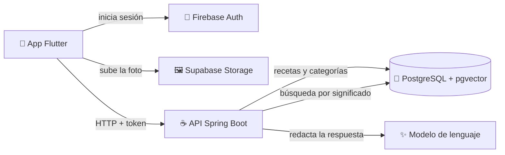

<div align="center">

# 🍳 Recetario · Backend

**La API detrás de un recetario que cocina contigo**


[📱 App móvil](https://github.com/Fernando-Castro-Hernandez/recetario-frontend) ·
[Cómo se conecta todo](#-cómo-se-conecta-todo) ·
[Arquitectura](#-arquitectura) ·
[Puesta en marcha](#-puesta-en-marcha) ·
[Roadmap](#-roadmap)

</div>

---

> 🚧 **En construcción.** Ya se pueden consultar, crear, editar y borrar recetas (con foto); lo marcado como *planeado* todavía no está implementado. El [roadmap](#-roadmap) dice qué existe y qué falta.

## 🥘 ¿Qué es?

**Recetario** es una app móvil para guardar tus recetas y cocinar con ayuda de un asistente que responde **con base en tus propias recetas**: *"¿qué hago con pollo y arroz en 20 minutos?"*.

Este repositorio es el **backend**: una API REST que guarda las recetas, las busca y, más adelante, conversa sobre ellas. La app que la consume vive en [`recetario-frontend`](https://github.com/Fernando-Castro-Hernandez/recetario-frontend).

## 🔌 Cómo se conecta todo



| Pieza | Para qué sirve |
|---|---|
| **Firebase Auth** | Sabe quién eres: registro, login y Google. Entrega un token a la app. |
| **Supabase Storage** | Guarda la foto de cada receta y devuelve una URL pública. |
| **API Spring Boot** *(este repo)* | Recibe las peticiones de la app, valida el token y aplica las reglas del negocio. |
| **PostgreSQL** | Guarda recetas y categorías. Con **pgvector** también guarda el "significado" de cada receta para poder buscarla por lo que dice y no solo por su nombre. |
| **Modelo de lenguaje** | Redacta la respuesta del asistente usando las recetas encontradas. |

## 🧱 Stack

| Capa | Tecnología | Estado |
|---|---|---|
| Lenguaje | Java 21 | ✅ |
| Framework | Spring Boot 4.1.3 (Web MVC) | ✅ |
| Persistencia | Spring Data JPA + PostgreSQL (Supabase) | ✅ |
| Migraciones | Flyway | ✅ |
| Validación | Jakarta Validation | ✅ |
| Documentación | SpringDoc OpenAPI (Swagger UI) | ✅ |
| Mapeo | MapStruct | ✅ |
| Seguridad | OAuth2 Resource Server (tokens de Firebase) | 🔜 planeado |
| IA | Spring AI + pgvector (RAG) | 🔜 planeado |

## 🏛 Arquitectura

Arquitectura **por capas orientada al dominio** (estilo puertos y adaptadores). La regla central:

- El **dominio** se escribe en **inglés** (`Recipe`, `Category`, `RecipeService`).
- La **persistencia** (entidades JPA y tablas) se escribe en **español** (`Receta`, `Categoria`).
- **MapStruct** traduce entre ambos mundos: una entidad nunca sale hacia los controladores.

```text
mx.edu.tecdesoftware.recetario
├── web
│   ├── controller        → endpoints REST; solo habla con los servicios
│   └── exception         → convierte los errores en respuestas JSON (400)
├── domain                → modelos de dominio (inglés)
│   ├── service           → reglas del negocio
│   ├── repository        → interfaces del dominio (los "puertos")
│   └── exception         → errores del negocio (p. ej. categoría inexistente)
└── persistence           → implementaciones de esas interfaces (los "adaptadores")
    ├── entity            → entidades JPA (español)
    ├── crud              → repositorios de Spring Data
    └── mapper            → MapStruct: entidad ⇄ dominio
```

Las tablas viven en `src/main/resources/db/migration` como scripts versionados de **Flyway** (`V1__crear_tablas.sql`, `V2__datos_iniciales.sql`, `V3__agregar_imagen_url.sql`). Cada script corre una sola vez, así la base de datos queda registrada en el repositorio. Un script que ya corrió **no se edita** (Flyway guarda su checksum): cada cambio nuevo va en un script nuevo.

## 🚀 Puesta en marcha

**Requisitos:** JDK 21 y un proyecto de [Supabase](https://supabase.com). El Gradle Wrapper viene incluido.

1. Copia `src/main/resources/application-dev.properties.example` como `application-dev.properties` (ignorado por Git) y llena tu usuario y contraseña del **Session pooler** de Supabase.
2. Arranca la API. Al iniciar, **Flyway** aplica los scripts que falten: la primera vez crea las tablas y carga 13 recetas de ejemplo.

```powershell
.\gradlew.bat bootRun          # API en http://localhost:8090
.\gradlew.bat build -x test    # solo compilar
```

En Linux/macOS usa `./gradlew`.

**Swagger UI:** http://localhost:8090/swagger-ui.html

### Endpoints

| Método | Ruta | Descripción |
|---|---|---|
| `GET` | `/recipes` | Todas las recetas, ordenadas por nombre, con su categoría |
| `GET` | `/recipes/{id}` | Una receta (`404` si no existe) |
| `GET` | `/recipes/category/{id}` | Recetas de una categoría |
| `POST` | `/recipes` | Crea una receta → `201` con la receta y su categoría (`400` si los datos no son válidos) |
| `PUT` | `/recipes/{id}` | Edita una receta → `200` (`400` datos inválidos, `404` si no existe) |
| `DELETE` | `/recipes/{id}` | Borra una receta → `200` (`404` si no existe) |
| `GET` | `/categories` | Categorías activas ordenadas por nombre (para el formulario y los filtros) |

**Ejemplo de `POST /recipes`** (el `recipeId` lo genera la base de datos y la receta nace activa; `imageUrl` y `description` son opcionales):

```json
{
  "name": "Molletes",
  "description": "Bolillo con frijoles y queso gratinado.",
  "ingredients": "2 bolillos\n1 taza de frijoles refritos\n100 g de queso Chihuahua",
  "instructions": "1. Parte los bolillos.\n2. Úntalos con frijoles y agrega el queso.\n3. Hornea 10 minutos.",
  "prepTime": 15,
  "servings": 2,
  "imageUrl": "https://example.com/molletes.jpg",
  "categoryId": 1
}
```

**Reglas de validación:** `name`, `ingredients` e `instructions` son obligatorios; `name` admite 120 caracteres, `description` 300 e `imageUrl` 500; `prepTime` y `servings` deben ser mayores a 0; `categoryId` debe ser una categoría que exista. Si algo falla, la respuesta es `400` con el error de cada campo:

```json
{
  "status": 400,
  "message": "Datos inválidos",
  "errors": {
    "name": "El nombre es obligatorio",
    "prepTime": "El tiempo de preparación debe ser mayor a 0"
  }
}
```

## 🗺 Roadmap

- [x] Proyecto inicial con Spring Initializr
- [x] Credenciales fuera del repositorio desde el primer día
- [x] Conexión a PostgreSQL (Supabase) con perfil `dev`
- [x] Tablas y 13 recetas de ejemplo con migraciones de Flyway
- [x] Consultar recetas con su categoría (`GET /recipes`)
- [x] Crear, editar y borrar recetas (`POST`, `PUT`, `DELETE`)
- [x] Foto de la receta (`imageUrl`)
- [x] Validación de datos con errores claros (`400`)
- [x] Categorías para el formulario y los filtros (`GET /categories`)
- [ ] Acceso solo con sesión iniciada (token de Firebase)
- [ ] Asistente de cocina con RAG

## 🎓 Contexto

Proyecto Integrador de la materia **Desarrollo FrontEnd** (TecDeSoftware), por [Fernando Castro Hernández](https://github.com/Fernando-Castro-Hernandez).
